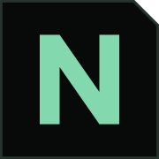

  

<h1 align="center">Noverna Studio</h1>

  <b>The IDE for game modders.</b> 
  Frameworks, builds, game sessions and decompiling in one place.

  
  
  

---

> **Early access.** Noverna Studio is in active development. Expect rough edges, and keep backups of your mods and saves.

## Download

| | |
| --- | --- |
| **Installer** (recommended, updates itself) | [NovernaStudio-win-Setup.exe](https://github.com/NovernaLabs/noverna-studio-releases/releases/latest/download/NovernaStudio-win-Setup.exe) |
| **Portable** (no install, no auto-update) | [NovernaStudio-win-Portable.zip](https://github.com/NovernaLabs/noverna-studio-releases/releases/latest/download/NovernaStudio-win-Portable.zip) |

All versions and changelogs: [Releases](https://github.com/NovernaLabs/noverna-studio-releases/releases).

Windows 10 or 11, 64-bit. The .NET runtime is included. The installer isn't code-signed yet, so Windows SmartScreen may warn on first start: *More info → Run anyway*.

## What it does

- **Games**: finds your Steam games, shows engine, Unity version, Mono/IL2CPP and architecture.
- **Frameworks**: installs, updates and removes BepInEx and MelonLoader with one click.
- **Projects**: new mod projects from templates, referencing the game's assemblies, building into a clean `dist` folder.
- **Editor**: C# with IntelliSense (Roslyn), go to definition into decompiled game code (ILSpy engine), rename, find references, quick fixes.
- **Run**: build and start the game in a session, with the game log next to your code. Clean sessions leave your game folder as it was.
- **Assets**: browse Unity assets and scenes for local analysis.

## Updates

The installed version checks for updates on start and offers *Update & restart*. Nothing is installed without your click.

## Feedback

Bugs and ideas are welcome in [Issues](https://github.com/NovernaLabs/noverna-studio-releases/issues). Please add your Noverna Studio version, the game and the framework.

## About this repository

This repository only holds the release builds of Noverna Studio. The source code is private.

© NovernaLabs
